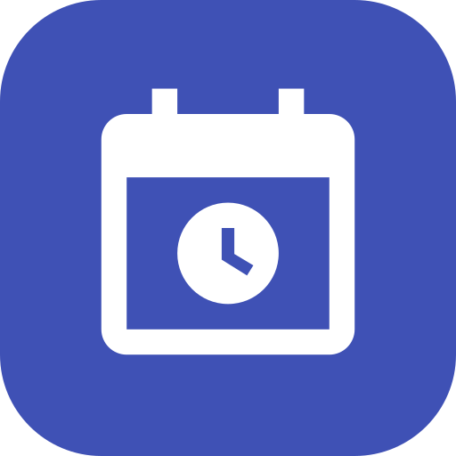

<h1 align="center">
  
  Calendar Alarm
</h1>

<p align="center">
  <strong>Real alarms, not just notifications, for the calendar events that matter.</strong>
</p>

<p align="center">
  
  
  
  
  
</p>

<p align="center">
  <a href="#-features">Features</a> •
  <a href="#-usage">Usage</a> •
  <a href="#-building-and-installing">Build &amp; install</a> •
  <a href="#%EF%B8%8F-how-it-works">How it works</a> •
  <a href="#-troubleshooting">Troubleshooting</a>
</p>

---

Your calendar already knows when things happen. Calendar Alarm turns selected events into loud, snoozable,
full-screen alarms, so you can't miss them because a notification slipped by.

## ✨ Features

- ⏰ **Rings at event start** for any timed event that is either:
  - in a calendar named **Alarm** (any capitalization), or
  - tagged **`#alarm`** in its title or description, in any calendar.
- 🔊 **A real alarm experience.** It uses your system alarm sound and alarm volume, vibrates, and shows a
  full-screen alarm over the lock screen. It loops until you act on it, then stops on its own after 10 minutes.
- 😴 **Snooze for 5 minutes.** A silent "Snoozed" notification shows a live countdown and a **Dismiss alarm**
  button that cancels the re-ring.
- 🔄 **Stays in sync without being opened.** Alarms are rescheduled automatically when your calendar changes,
  after a reboot, after an app update, and after each alarm rings.
- 🔁 **Handles recurring events.** Each occurrence of a repeating event rings.
- ✅ **Guided setup.** A step-by-step checklist walks you through every permission and system setting the app
  needs to work reliably, linking straight to the right screen.
- 🧪 **A built-in test.** "Test alarm in 10 seconds" lets you check everything without creating an event.

## 📱 Usage

1. Install the app and open it.
2. Complete the setup checklist on the home screen. Each step tells you exactly what to tap.
3. Mark events that should ring, either way works:
   - Create a calendar named `Alarm` in Google Calendar and put events in it.
   - Add `#alarm` anywhere in an event's title or description.
4. That's it. The **Next alarm** card on the home screen shows what will ring next. Events that will ring are
   marked **Rings at start** in the upcoming events list.

When an alarm rings, choose **Snooze 5 min** or **Dismiss**, from the notification or the full-screen screen.

### 🎯 Matching rules

| Rule | Detail |
|---|---|
| Alarm calendar | The name must be exactly `Alarm`. Capitalization and surrounding spaces are ignored. Its events ring even if the calendar is hidden in your calendar app's view. |
| `#alarm` tag | Matched as a whole tag in any capitalization. `#Alarm` matches. `#alarms` and `#alarmclock` don't. Only applies to calendars that are visible. |
| All-day events | Never ring, since they would go off at midnight. |
| Canceled events | Never ring. |
| Same start time | Events that start at the same moment ring together, each with its own notification. |

## 🛡️ Setup checklist

The home screen won't show your events until every step is complete. Steps already allowed show a check mark,
and statuses refresh whenever you return to the app.

| | Step | Why it's needed |
|:-:|---|---|
| 📅 | Read your calendar | To find upcoming events. |
| 🔔 | Show notifications | The alarm is delivered as a high-priority notification. |
| ⏱️ | Schedule exact alarms | To fire at the exact start time instead of a delayed, batched time. Off by default on Android 14+. |
| 🖥️ | Full-screen alarms | To take over the screen while the phone is locked. |
| 🔋 | Unrestricted battery | So battery saving doesn't delay or block the background calendar-change checks. |
| 💤 | Keep active when unused | Stops Android from pausing the app and removing its permissions after months without opening it. |

## 🔨 Building and installing

### 📋 Requirements

| Tool | Version |
|---|---|
| JDK | 21. The Gradle daemon is pinned to 21 via `gradle/gradle-daemon-jvm.properties`. |
| Android SDK | Platform 37 (Android 17), plus Platform Tools for `adb`. |
| Gradle | 9.8.2, via the included wrapper. No separate install needed. |
| Device | Android 8.0 (API 26) or newer. |

Built with Kotlin 2.4, Jetpack Compose with Material 3, and Android Gradle Plugin 9.5. AGP 9's built-in Kotlin
support is used, so there is no separate Kotlin Android plugin.

### 🧰 First-time tooling setup (Linux, no Android Studio)

Android Studio works fine and handles all of this for you. To work from the command line instead:

```bash
# 1. JDK 21, e.g. Eclipse Temurin, unpacked anywhere
#    https://adoptium.net/temurin/releases/?version=21

# 2. Android command-line tools
#    https://developer.android.com/studio#command-line-tools-only
mkdir -p ~/Android/Sdk/cmdline-tools
unzip commandlinetools-linux-*_latest.zip -d /tmp/ct
mv /tmp/ct/cmdline-tools ~/Android/Sdk/cmdline-tools/latest

export ANDROID_HOME="$HOME/Android/Sdk"
export PATH="$ANDROID_HOME/platform-tools:$ANDROID_HOME/cmdline-tools/latest/bin:$PATH"

yes | sdkmanager --licenses
sdkmanager "platform-tools" "platforms;android-37.0"

# 3. Point the project at your SDK. This file is gitignored.
echo "sdk.dir=$ANDROID_HOME" > local.properties
```

If JDK 21 isn't somewhere Gradle auto-detects, tell Gradle where it is in `~/.gradle/gradle.properties`:

```properties
org.gradle.java.installations.paths=/path/to/jdk-21
```

Gradle downloads any missing build tools automatically on the first build.

### 🏗️ Build

```bash
./gradlew assembleDebug
# APK: app/build/outputs/apk/debug/app-debug.apk
```

### 📲 Install on a phone

Enable **Developer options** on the phone (Settings > About phone > tap **Build number** 7 times), then pick a
connection.

🔌 **USB:** turn on **USB debugging**, plug in, and accept the prompt on the phone.

📶 **Wireless (Android 11+):** turn on **Wireless debugging**, tap **Pair device with pairing code**, then:

```bash
adb mdns services                  # finds the pairing and connect ports
adb pair <ip>:<pairing-port> <code>
adb connect <ip>:<connect-port>    # usually automatic after pairing
```

Then install and launch:

```bash
./gradlew installDebug
adb shell am start -n com.jason.calendaralarm/.MainActivity
```

Once installed, the phone doesn't need to stay connected. The app runs on its own.

## ⚙️ How it works

Calendar Alarm never runs a background service and keeps no copy of your events. It reads the on-device calendar
fresh each time and keeps **one** system alarm pointed at the next event that should ring.

```text
              calendar change / boot / app update / app opened
                                  |
                                  v
                        +-------------------+
                        |   scheduleNext()  |  query calendar for the earliest
                        +-------------------+  alarm event after now
                                  |
                                  v
                    AlarmManager.setAlarmClock(start time)
                                  |
                           (event starts)
                                  v
                        +-------------------+
                        |   AlarmReceiver   |  re-query: still exists? ring it
                        +-------------------+
                          |               |
                 ring notification     scheduleNext(after = this start)
                 + full-screen UI      (chains to the following event)
```

- **Exact, Doze-proof alarms.** `AlarmManager.setAlarmClock` is the strongest alarm type Android offers. It
  fires on time in battery-saving idle mode, is exempt from App Standby, and shows the alarm icon in the status bar.
- **Chaining.** Each alarm schedules the next one as it rings. It uses the original start time, not the current
  time, so a late-firing alarm catches up instead of skipping events.
- **Calendar change detection.** A `JobScheduler` content-trigger job watches `content://com.android.calendar`.
  This includes changes synced down from Google. The job reschedules within roughly 5 to 60 seconds, then re-arms
  itself.
- **Re-checked before ringing.** When an alarm fires, the app checks the calendar again, so events that were
  deleted, moved, or untagged since scheduling don't ring.
- **Reboots and updates.** A broadcast receiver rebuilds the alarm and the job after `BOOT_COMPLETED`,
  `MY_PACKAGE_REPLACED`, and when exact-alarm permission is granted.
- **Ringing.** The alarm notification uses a high-importance channel with the alarm audio usage, `FLAG_INSISTENT`
  so the sound loops, a full-screen intent for the lock screen, and a 10-minute timeout.
- **Snooze.** Each snooze is its own one-off `setAlarmClock` alarm, separate from the next-event chain. That keeps
  snoozing one event from delaying another.

### 🗂️ Project structure

```text
app/src/main/java/com/jason/calendaralarm/
├── MainActivity.kt              Entry point and Material 3 theme with dynamic color
├── ui/HomeScreen.kt             Setup checklist, next alarm card, upcoming events
├── permissions/PermissionStep.kt  Each setup step: how it's checked and where it links
├── calendar/CalendarRepository.kt Calendar queries and alarm matching rules
└── alarm/
    ├── AlarmScheduler.kt        Next-event alarm, snooze, and test alarms
    ├── AlarmReceiver.kt         Fires alarms and handles snooze, dismiss, boot, and update
    ├── AlarmNotifications.kt    Ringing and snoozed notifications and their channels
    ├── AlarmActivity.kt         Full-screen alarm over the lock screen
    └── CalendarChangeJob.kt     Reschedules when the calendar provider changes
```

## ⚠️ Limitations

- **Force stop disables everything.** Settings > Apps > Force stop puts the app in Android's stopped state, which
  clears its alarms and blocks background work until you open it again. No app can opt out of this. Swiping the
  app out of recents is fine on Pixel and stock Android. Some manufacturers' phones, like Xiaomi, Huawei, and
  OnePlus, treat that swipe as a force stop.
- **Pending snoozes don't survive a reboot.** The next-event alarm is restored after a reboot, but a snooze that
  was waiting is not.
- **It only sees what has synced to the phone.** Events added on the web appear only after your calendar app
  syncs them to the device.
- **Do Not Disturb** lets alarms through by default. If you've changed that setting, alarms may be silenced.

## 🩺 Troubleshooting

**🗓️ A new calendar or its events don't show up.**
Calendar Alarm reads the phone's local calendar database. For a newly created Google calendar, the phone often
syncs the calendar itself first and its events later.
1. In Google Calendar, go to Settings, tap the calendar, and make sure **Sync** is on.
2. Then go to Android Settings > Passwords & accounts > *your account* > Account sync, tap the menu, and choose
   **Sync now**.

If the event appears in the Google Calendar app on the phone, Calendar Alarm can see it too.

**🔕 An alarm didn't ring.**
- Open the app and check every setup step has a check mark.
- Check that the **Next alarm** card shows the event you expect.
- Make sure the event isn't all-day.
- Make sure the app wasn't force-stopped since you last opened it.

**🔍 Can't find the app when searching "calendar."**
The Pixel Launcher's search favors the exact match, Google Calendar. Search for "calendar a," or add the app to
your home screen.

**💻 Check what's scheduled from a computer:**

```bash
adb shell dumpsys alarm | grep -A3 'com.jason.calendaralarm'
adb shell dumpsys jobscheduler com.jason.calendaralarm | grep -A3 'CalendarChangeJob'
```
